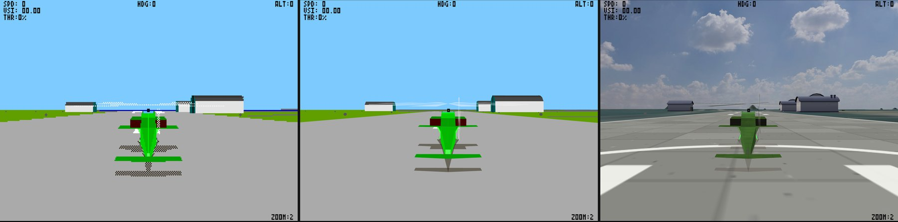
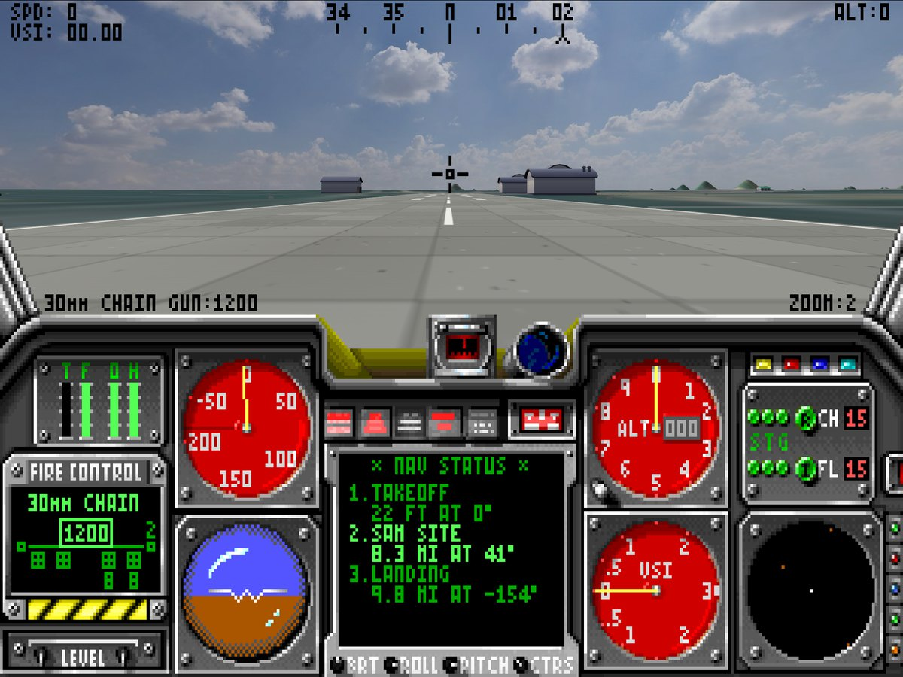
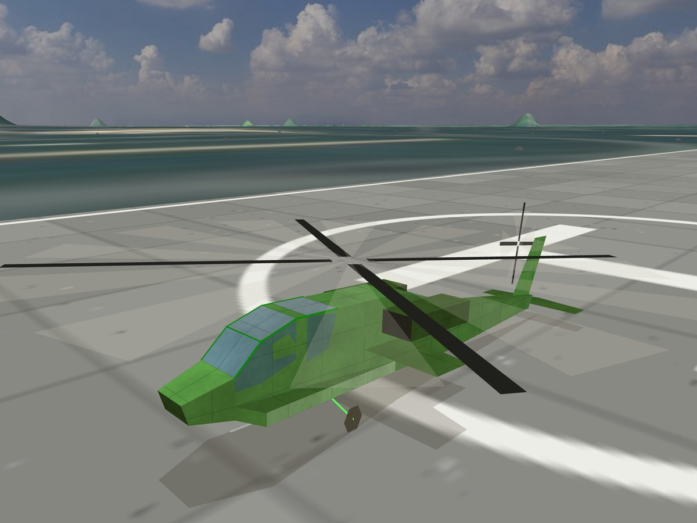
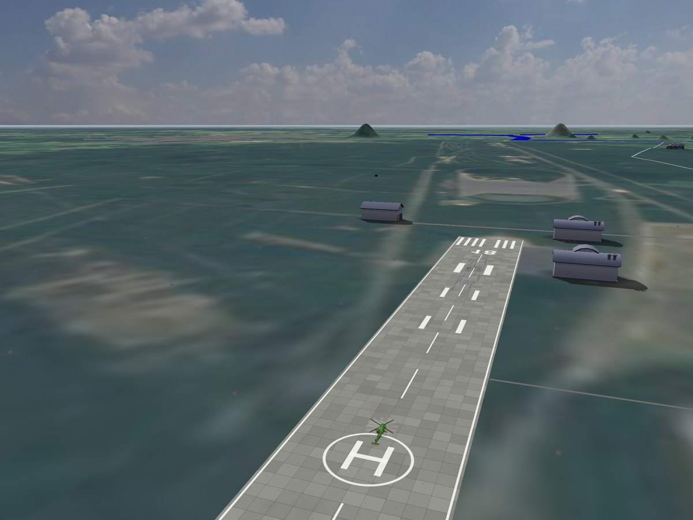

# LHX: Attack Chopper — GPU 3D

The original 1990 **LHX: Attack Chopper** (Electronic Arts) running in the browser, unmodified, on a
PC emulated in JavaScript, with its 3D world redrawn by the GPU. All game logic, flight model,
missions and cockpit are the original machine code; only the 3D drawing is taken over.


*The same moment three ways: the game's own 320 × 200 renderer, GPU **Accurate** (the original
graphics drawn in 3D at full resolution) and GPU **Enhanced**.*

## How it works

- **The real game, emulated.** `LHX.EXE` runs on an 80186-class CPU, the PC hardware it touches
  (interrupt controller, timer, keyboard, VGA mode 13h, PC speaker) and the BIOS and DOS services it
  calls, all written in JavaScript. Nothing in the game is patched.
- **3D read out of the running game.** Hooks on a few addresses in the game's engine read every
  model it draws, right after its own transform: camera-space points, polygons, lines, colours, the
  camera and each object's position and angles.
- **Redrawn on the GPU.** three.js/WebGL draws those models at full display resolution with a depth
  buffer, using a projection fitted to the game's own. The game's frame is laid on top with its 3D
  area keyed out, so the cockpit, instruments and HUD are the original pixels.

## Modes

| Mode | What it shows |
|---|---|
| **GPU, accurate** | the original graphics in 3D: the game's models, colours and horizon, drawn by the GPU at full resolution |
| **GPU, enhanced** | everything new, kept out of Accurate: photo skies, real satellite terrain with relief for each theatre, concrete runways with markings, modern models for buildings and trees, lit and painted aircraft and vehicles with generated surface detail, spinning rotor blades, sun shadows, a four times longer draw range |
| **game's own** | the original 320 × 200 software renderer |



| | |
|---|---|
|  |  |

### Enhanced mode in short

- **Terrain where the game is set.** Each theatre (Libya, Vietnam, East Germany) is placed on the
  real map by fitting the game's town positions to their real coordinates, then built from
  Sentinel-2 satellite imagery and elevation data: the Nafusa escarpment in Libya, the Annamite
  ridges west of Dong Ha, the flat Altmark farmland. The game's flat ground and logic stay as they
  are; the relief is a display warp that keeps the helicopter's height above the ground.
- **The game's hills** become smooth mounds of the terrain, staying inside the game's own hill shapes.
- **Runways** are concrete with slab joints, tyre marks, threshold bars, heading numbers and a helipad.
- **Buildings, tents and trees** are replaced by Kenney low-poly models at the game's positions and sizes.
- **Aircraft and vehicles** keep their original shapes but are lit by the sun and sky, toned to
  service paint, given panel lines or camouflage, and drawn solid; rotors get spinning blades.
- **Shadows** from the sun for buildings, trees and vehicles, plus contact darkening.

## Run

You need your own copy of the game: `LHX.EXE` and `LHX0.LIB` … `LHX4.LIB` (the 1995 "Hit Squad"
CD release was used). They are not included.

```bash
git clone https://github.com/kznsq/lhx-attack-chopper-gpu
cd lhx-attack-chopper-gpu
ln -s /path/to/your/LHX game        # or skip this: the page then asks for the folder
python3 -m http.server 8642 --bind 127.0.0.1
```

Open http://127.0.0.1:8642/, click the screen to give it the keyboard and choose the 3D mode under
the screen. The game starts with `VGA KEYBOARD HIGH PCSOUND`, as `START.BAT` does. A browser with
WebGL 2 is needed; Enhanced mode loads about 25 MB of terrain and models.

**Keys:** keypad 1–9 or arrows move the flight stick (5 or `/` centres it), the top-row number
keys set the collective (5 is full), Space fires, Enter selects the next target, `[` `]` pick a
weapon, F1–F10 change the view (F1 cockpit, F5 chase), Ctrl + arrows look around, Ctrl-P pauses,
Ctrl-Q aborts the mission. In the menus, the left and right arrows choose the theatre on the world
map.

Headless (macOS JavaScriptCore shell, no Node needed):

```bash
/System/Library/Frameworks/JavaScriptCore.framework/Versions/A/Helpers/jsc -m tools/run.mjs -- <game dir> <out dir> <seconds> "26:enter,30:enter"
```

writes a PPM screenshot per emulated second and prints the services and ports the game used.

## Credits and licences

- Code in this repository: MIT licence (see `LICENSE`).
- *LHX: Attack Chopper* © 1990 Electronic Arts. This project is not affiliated with or endorsed by
  Electronic Arts. No game files are included; the screenshots show the game running in this project.
- [three.js](https://threejs.org) (MIT), loaded from a CDN.
- Photo skies: Kloofendal 48d Partly Cloudy and Qwantani Night by [Poly Haven](https://polyhaven.com), CC0.
- Satellite imagery: [Sentinel-2 cloudless](https://s2maps.eu) 2016 by EOX IT Services GmbH
  (contains modified Copernicus Sentinel data 2016), CC BY 4.0.
- Elevation: [Terrain Tiles](https://registry.opendata.aws/terrain-tiles/) on AWS Open Data
  (Mapzen terrarium; sources include SRTM, GMTED2010, ETOPO1 and others).
- Town coordinates for georeferencing: © [OpenStreetMap](https://www.openstreetmap.org/copyright) contributors (ODbL).
- Models: [Kenney](https://kenney.nl) Nature Kit, Survival Kit, City Kit (Industrial), City Kit (Suburban), CC0.

## Technical notes

### Layout

| File | Contents |
|---|---|
| `src/cpu.js` | real-mode x86 (8086 + 80186 instructions), address hooks |
| `src/pc.js` | memory, 8259, 8253, keyboard controller, VGA registers and DAC, timing |
| `src/dos.js` | BIOS (INT 10h, 16h, 1Ah, 9, 8) and DOS (INT 21h) services, memory blocks, EXE loader, files |
| `src/keys.js` | browser key codes → PC scancodes |
| `src/capture.js` | reads each frame's 3D scene out of the running game (see below) |
| `src/composite.js` | keys the game's own 3D out of its frames, records each window's horizon and camera (angles, world position) |
| `src/reach.js` | Enhanced mode: draws the world four times farther out than the game does |
| `src/theatre.js` | which theatre is loaded (Libya, Vietnam, East Germany), from the archive entry the game reads |
| `web/gpu.js` | draws the captured scene with three.js / WebGL: Accurate and Enhanced modes |
| `web/main.js` | page: screen, keyboard, renderer mode, speed, PC-speaker sound |
| `assets/sky/` | photo skies for Enhanced mode (Poly Haven, CC0; see `SOURCE.txt`) |
| `assets/models/kenney/` | replacement models for Enhanced mode (Kenney, CC0; licence files inside) |
| `docs/` | screenshots |
| `assets/terrain/` | Enhanced-mode terrain per theatre, built by `tools/terrain.py` (its tile download cache, `tiles/`, is not in the repository) |
| `tools/terrain.py` | georeferences a theatre and builds its terrain from satellite imagery and elevation tiles |
| `tools/probe.mjs`, `tools/capture-probe.mjs` | headless discovery runners |
| `tools/testkit.js` | browser-console helpers for tests: start a mission, snapshot, re-render a captured frame from any camera |

### Hooks

`cpu.hook(linear, fn)` runs `fn(cpu)` before the instruction at that linear address. It can read
registers and memory and let the instruction run (return `false`), or change CS:IP itself and
skip it (return `true`). Every interrupt vector starts at a one-byte IRET stub with such a hook,
which is how the BIOS and DOS services are provided.

The unpacked program image is loaded at segment 0x0811, so an address `X` in the unpacked image
is linear `0x8110 + X`.

### GPU rendering

The GPU draws each frame's 3D models with WebGL from data read inside the running game; the game
itself is unchanged.

| Image address | What the capture does there |
|---|---|
| `0x140ce` | scene renderer: horizon fill (`0x1805e`), then a list of draw descriptors, one model each |
| `0x1cad8` | per-model draw routine: builds the rotation from the object's angles, transforms the points |
| `0x1cbae` → `0x1cc5f` | skips the "nothing moved, redraw from cached screen coordinates" shortcut, so every model is transformed every frame |
| `0x1cd76` | right after the transform: camera-space points (`[0x70e]`, 16 bytes each), the level-of-detail record (`[0xf209]`, primitives with the 256-colour face colours) and the model record (`[0xf207]`) are read |
| `0x11096` | the frame is copied to video memory, one 3D window at a time; the captured models are handed to the GPU |

Projection (fitted to the game's own projected coordinates): screen x = cx + 2ⁿ·X/Z and
screen y = cy − (15/16)·2ⁿ·Y/Z, with n = `[0xf02f]` (7 for the main view, 8 when zoomed) and
cx, cy = `[0xeb52]`, `[0xeb54]`. Each 3D window (main view, cockpit camera) has its own centre.
Sphere radius in camera units = radius << `[0xf1ff]`.

Each model's camera-space points come in its own unit. Model units are 2ⁿ half-feet, n = the
signed byte at model record `+0xc`; the draw-list builder (`0x16b07`) then shifts each object's
points left by `[0xf1ff]` so its largest coordinate fills 16 bits. Points × 2^(n − `[0xf1ff]`) are
half-feet for every model, which is what lets the depth buffer compare models (checked: the
runway plane comes out exactly the camera's world height below the camera). Camera world
position: `[0xf01b]`, `[0xf01f]`, `[0xf023]`; object world position: object `+6`, `+0xa`, `+0xe`
(32-bit, 24.8 fixed point, half-feet; x east, y up, z north).

The game draws point fields (the ground-dot field, stars) first, then flat models lying at height 0
(runways, roads), then the models, and nothing in the first two hides anything after it. A landed
helicopter's model reaches about 8 ft below the runway and is still drawn whole. The GPU draws the
same three layers, clearing the depth buffer before each, so only models hide models.

The game's one-sided faces are clockwise on screen, so they are three.js back faces. Coplanar
detail polygons (runway numbers, windows) are ranked by area within their plane, snapped onto the
largest polygon's plane (the game's fixed-point transform leaves vertices several units off) and
moved slightly toward the eye along their line of sight. A vertex shared with a face outside its
group is not snapped: moving it opened cracks of up to 2 half-feet in the helicopters.

### Modes

The page has three 3D renderers, switchable while playing:

| Mode | What it shows |
|---|---|
| GPU, accurate | the game's 3D drawn by the GPU at full resolution, matching the game's own picture: its colours, its horizon line, its models |
| GPU, enhanced | additions on top of Accurate, kept separate: a photo sky (day or night by the game's sky colour) above the true 3D horizon, haze at the horizon, real terrain (where built) |
| game's own | the original 320 × 200 software renderer |

### Compositing

Right after the scene renderer has filled a 3D window with sky and ground (image `0x1468a`), the
window is read (sky and ground colours, the horizon line fitted to the colour boundary, the camera
angles), filled with palette index 255 (never shown by the game) and every CPU write into it is
dropped until the scene renderer returns (`0x14792`). The per-scanline "solid colour" table at
`[0xed3c]` is set to mixed, or the game would skip refilling those lines next frame. Two calls stay
unfiltered: the symbol pass after the models (`0x6e:2f12`, the target box) and effect primitives
(explosions, `0x1aa0d`), which the game draws in 2D. HUD, text and canopy frame are drawn after the
scene renderer, so they end up on top of index 255; the page shows the game's frame over the GPU
picture with 255 transparent. The attitude-indicator ball is drawn by the same scene renderer and
comes out at full resolution too.

Camera: heading, pitch and roll at `[0xf027]`, `[0xf029]`, `[0xf02b]` (2880 per turn), read while the
window is drawn. World-to-camera rotation = Rz(roll)·Rx(pitch)·Ry(heading), world axes east, up,
north; the game's camera space squeezes Y by 0.868 (both fitted to captured objects). The game's
2D horizon moves about 2/3 as fast as its 3D projection (a linear approximation); Accurate keeps
the game's line, Enhanced uses the true one.

### Timing

Emulated time is counted in instructions: `ips` instructions are one second. The game runs its
logic per frame, so the speed slider changes how fast it plays; 6 MIPS is about a fast 386.

### Terrain (Enhanced mode)

`python3 -I tools/terrain.py <battlefields dir> assets/terrain [gulf asia europe]` builds the
theatres; all three are built and included. It needs each theatre's place names and object
positions as JSON, made by a separate extractor for the game's theatre files that is not part of
this repository, and downloads about 3,800 source tiles (49 MB, cached in `assets/terrain/tiles/`).
Without a theatre's files, Enhanced mode shows the game's flat ground colour.

- **Theatres.** Libya: scale 1.53, the Nafusa escarpment (91–715 m). Vietnam: scale 1.50, coastal
  plain with the Annamite ridges to the west (up to 1,687 m). East Germany: scale 2.03, the flat
  Altmark (13–157 m).
- **Placement.** The game's maps are schematic: real distances are 1.5–2 times the game's. Each
  theatre is placed by a similarity transform (scale, rotation, shift) fitted to the game's town
  positions and their real coordinates (OpenStreetMap). The real land is squeezed by that scale,
  heights included. Libya: scale 1.53, rotation −19°, towns within 4–7 km. The game's "Nafusah
  Mountains" falls on the real Nafusa escarpment, its "Jifarah Plain" on the real plain.
- **Data.** Colour: Sentinel-2 cloudless 2016 by EOX IT Services GmbH (contains modified Copernicus
  Sentinel data 2016), CC BY 4.0. Over bright desert that mosaic clips red and green; they are
  rebuilt from blue with the colour ratios of the unclipped ground, then balanced to a sand colour.
  Green imagery (Vietnam, East Germany) reads too dark from the air; a gamma curve brings its
  median brightness to 0.36 (gamma about 0.66), keeping highlights. The photo skies are shown at
  78% of their brightness so land and sky balance.
  Heights: Terrain Tiles on AWS Open Data (terrarium encoding; SRTM, GMTED and others). Runways are
  levelled, as real airfields are.
- **Files.** Per theatre: a detailed grid over the play area (`_near`, 6144² colour at 5.5 m,
  1024² heights) and a coarse one 160 km across (`_far`). Heights are int16 game half-feet, rows
  from north to south.
- **Relief without changing the game.** The game's ground stays flat at height 0 and its logic is
  untouched. On screen every point is raised by the terrain height under it, less the height under
  the camera, so the camera keeps the game's height above the ground. Models move up as a whole by
  the height under their origin, and one reaching below the ground (a helicopter parked at height 0)
  is lifted onto it. Ground markings are cut into 400-unit pieces and set exactly on the terrain:
  the game's rounded heights would sink them when seen from low down. With terrain, all layers
  share one depth buffer, so hills hide what is behind them.
- **The game's hills.** The game places hills and mountains as objects (`hill1`–`hill4`, `mountain`;
  42 in Libya, 152 in Vietnam, 127 in East Germany, listed in each terrain JSON by
  `tools/terrain.py`). With terrain they are drawn as smooth mounds of the terrain itself, textured
  and shaded like it: each sits on the real ground at the game hill's centre and heading, peaks at
  90% of its height and falls as a bell over a footprint 5% wider. The bell stays under the game's
  pyramid everywhere, so nothing the game keeps clear of a hill ends up inside the mound. The
  game's own hill polygons are not drawn then.
- **Light.** Terrain, runways and replacement models are dimmed by the game's sky colour: full under
  a day sky, about a third at dusk, 12% at night. The sky and ground colours come from the game's
  own table (`[[0xf019]]` ground, `+1` sky, passed to the horizon fill at `0x14687`), so a camera
  looking straight down (the mission-start fly-down) still knows whether it is day.
- **Loading.** The game reads its theatre file when the mission is chosen, about ten seconds before
  the first 3D frame; Enhanced mode loads the terrain (and uploads its textures), the replacement
  models and the runway concrete then, so nothing loads during the fly-down.
- **Known limit.** Symbols the game draws in 2D (the target box) are placed for flat ground, so
  over relief they can sit off the target they mark.

### Replacement models and runways (Enhanced mode)

Static game models are drawn with modern low-poly models from Kenney (CC0; `assets/models/kenney`,
licence files inside; the full kits are at kenney.nl): palms and trees
(Nature Kit), tents recoloured olive and huts (Nature and Survival kits), barracks and halls,
hangars, factories and oil tanks (City Kit Industrial), houses (City Kit Suburban). Each takes the
game object's position, heading (model x → (cos h, sin h), z → (−sin h, cos h), 2880 per turn, object
`+0x12`) and model box; buildings are sized half way between the game's box proportions and their
own, trees by height. Destroyed versions, vehicles, soldiers, towers, cranes and bunkers keep the
game's models. Kenney's sRGB colours are used unconverted, matching the page's palette output.

Runways are drawn as concrete: slabs and joints, weathering, tyre marks, edge stripes, threshold
bars, heading numbers at both ends, centre-line dashes and a helipad mark at the centre where the
helicopter starts. The texture is drawn by the page (no image files); the strip lies on the terrain
and under the ground markings, so shadows fall on it.

### Draw range (Enhanced mode)

The game draws an object only within its model's distance thresholds (record `+0xe`, `+0x10`, in
256 half-feet of x + y + z distance; hangars and tanks stop at about 7,500 half-feet, roughly a
kilometre) and inside a box around the camera chosen by the model's size class (`+0x16`, checked at
`0x19d65`; each class's box is twice the one before). In Enhanced mode `src/reach.js` divides the
distance the builder compares (`0x16ef2`) by 4 and moves the size class up by two (`0x19d6c`), so
objects appear four times farther away and keep their detailed model four times longer. The engine
transforms models in 16-bit numbers in each model's own units, and its own range keeps them in
bounds; an object gets the wider range only while its distance plus its radius stays under 0x7000
model units. Without that limit long roads and trails drawn far away wrapped around and appeared as
large shapes next to the camera. The draw list is used only by the scene renderer; Accurate mode keeps the game's range. Cost: at an
East German airbase 8 → 16 objects per frame and 59 → 42 game frames per second at 6 MIPS.

### Shadows and model lighting (Enhanced mode)

Surface detail: the game's models have no texture coordinates, so detail is generated per pixel from
each vertex's position in its model's own frame (from the game camera and the object's angles;
model → world is Rᵀ with R = Rz(roll)·Rx(pitch)·Ry(heading); a vertex stays within 0.12 half-feet
of its place over a turning, banking flight). Aircraft get panel lines (fading out before they
would shimmer) and fine paint variation, ground vehicles two-tone camouflage, both some wear.
Aircraft and vehicles are toned toward service paint, near-black paint lifted to dark olive grey.

Faces are drawn from both sides: the game's low-poly models are open where its back-face culling
never showed them. Rotors: the game draws a turning rotor as a fan of see-through sectors around a
hub vertex; each such fan gets four dark blades turning in its plane (main rotor about 3 turns a
second, tail rotor twice that) over a fainter blur, and see-through polygons that are not a rotor
(cockpit glass) are drawn more solid.

The game's own models are lit: each face's colour is scaled by its angle to the sun (from the
north-west, about 38° up) and to the sky, on the side the camera sees. Aircraft are toned from the
palette's bright colours toward service paint (a third of the saturation, darker, greens to olive
drab), and the rotor blur is drawn lighter. Ground vehicles, soldiers and structures cast shadows:
their faces are flattened along the sun direction and laid on the terrain point by point, in the
same stencil pass as the replacement models' shadows. Aircraft keep the game's own shadow models.

Replacement models cast sun shadows (the model flattened onto the ground at its foot along the sun
direction, from the north-west about 38° up, drawn half-dark with a stencil so overlaps darken once),
sit in a soft contact-darkening patch around their footprint, and are lit by sky light from above
with a darker bounce from below. All of it fades with the game's daylight.

### Layering on the ground (Enhanced mode)

Surfaces lying on the terrain are moved toward the eye by a fraction of their distance, which keeps
their order at every range (fixed height offsets lose it at grazing angles and flicker): runway
concrete 0.1%, the game's ground markings and the helicopter's shadow 0.2%, replacement-model
shadows, vehicle shadows and contact patches 1.2% (they lie on flat planes over terrain that can
slope). Lines are cut at the near plane like polygons; a line with one end behind the eye would
otherwise be projected through it and smeared across the screen.
